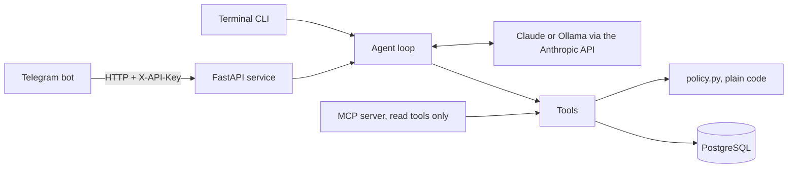
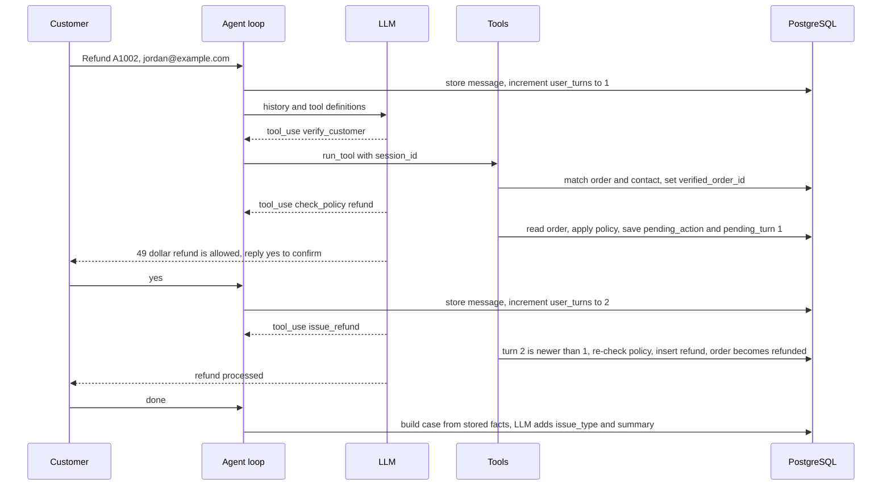

# Architecture

How the order support bot is built, why, and what it costs. This describes version 1.0.0 and
was checked against the code. Anything the code does not do is listed in section 10.

## 1. Goals and non-goals

**Goals**
- Reliability first: every rule that matters is enforced by code, not by the prompt.
- Testable without a model: policy, verification, confirmation and idempotency have
  deterministic tests that need no LLM and no API key.
- One agent loop shared by every interface (CLI, API, Telegram), so behaviour cannot drift.
- Model-agnostic: the same code runs on Claude or on a local model through Ollama.

**Non-goals**
- Real payment processing. A refund is a database record (see section 10).
- Retrieval over documents. The policy is code, so this project is about tools and
  verification, not RAG.
- Multi-tenant hosting, a staff dashboard or a web UI.

## 2. System overview

The model never touches the database or the policy directly. It can only ask the tool layer
to do something, and the tool layer decides.

## 3. Modules and the dependency rule

| Layer | Modules | Role |
|---|---|---|
| 0 | `config`, `schemas`, `prompts`, `policy` | constants, summary schema, prompts, store policy as pure functions |
| 1 | `llm`, `db` | the shared model client; all SQL |
| 2 | `tools`, `agent`, `cases` | tool handlers, the agent loop, end-of-chat case summary |
| 3 | `cli`, `api/`, `mcp_server`, `apps/telegram_bot` | interfaces that consume the core |

**Imports only go downward.** A lower layer never imports a higher one. This prevents circular
imports, and it is why the core has no dependency on FastAPI, Telegram or MCP. The Telegram bot
does not even import the core: it talks to the HTTP API only.

## 4. One request, end to end

A refund, simplified to one line per step (the model usually makes several tool calls per
customer message):

What to notice:
1. **`session_id` is passed by the application, never chosen by the model.** Handlers take it
   as their first argument, and the model's tool inputs cannot override it.
2. **After verification no tool takes an order ID.** `lookup_order`, `cancel_order` and
   `issue_refund` read `verified_order_id` from the session row.
3. **The write tool re-runs the policy.** State may have changed since `check_policy`, so
   `_execute` checks again before moving money.
4. **Every tool call is logged** to the `actions` table, success or failure.

## 5. State: what lives where

| State | Where | Written by |
|---|---|---|
| Verified order, failed attempts, lock, turn counter, pending action, last decision, action taken | `sessions` row | tool code and `agent.py` only, through an allow-list of field names |
| Conversation history | `messages` table, reloaded on every request | `agent.py` |
| Refunds, escalations, audit log, cases | their own tables | tool code and `cases.py` |
| Telegram chat to session map | memory of the bot process | `telegram_bot.py` (lost on restart) |

Because history and session state live in Postgres, the API process holds no conversation
state: each request rebuilds the agent from the database, so a container restart does not lose
a conversation.

## 6. Data model

| Table | Purpose | Notable constraints |
|---|---|---|
| `customers` | name, unique email, phone | email unique |
| `orders` | status, total, dates | `CHECK` on known statuses, non-negative amount, and a `delivered` order must have `delivered_at` |
| `order_items` | line items | positive quantity, non-negative price |
| `sessions` | server-side conversation state (section 5) | `pending_action` limited to `cancel` or `refund` |
| `refunds` | one row per refunded order | **`UNIQUE(order_id)`** |
| `escalations` | handoff requests with a reason | |
| `actions` | audit log of every tool call (input, result, ok) | |
| `cases` | saved summary per conversation | `outcome` limited to five known values |
| `messages` | conversation history | role limited to user, assistant or tool_result |

Policy limits are also expressed as `CHECK` constraints, so the database is a second line of
defence if application code ever has a bug.

## 7. Trust boundaries and threats

Treated as **untrusted**: customer messages, tool results (as far as the model is concerned),
MCP clients, anyone reaching the API or the Telegram bot. **Trusted**: the server code and the
database.

| Threat | Control | Residual risk |
|---|---|---|
| Someone claims an order that is not theirs | order ID plus email or phone must match; failure and "no such order" give the identical error | anyone who knows both values can verify, which is the verification model |
| Order ID enumeration | identical error for unknown order and wrong contact (tested) | |
| Brute-forcing contact details | 3 failures lock the session and escalate; a locked session gets a fixed message without calling the model | **the counter is per session**, so a new session starts a new count (section 10) |
| Prompt injection in customer text | customer text is data; enforcement lives in code, so injected instructions have nothing to unlock; `injection` eval scenario passed 3 of 3 on a 4B model | the model may still say odd things; it cannot change state |
| Instructions hidden in tool results | the prompt says tool results are data; the model's tools cannot move money without the code gates | free-text fields from a real store could influence wording |
| Double refund or replay | `UNIQUE(order_id)` with `ON CONFLICT DO NOTHING`; pending action cleared after use; policy re-checked | |
| Model skips confirmation | write tools refuse unless a newer customer message exists since the policy check | the code does not check that the message says yes (section 10) |
| Model invents promises ("3 business days") | prompt rule; measured by the eval (1 of 21 runs) | not enforced by code |
| MCP client supplies any `session_id` | the MCP server exposes read tools, policy and escalation only; no cancel or refund | only connect hosts you trust |
| API abuse | `X-API-Key` header, constant-time comparison, 503 if no key is configured | no rate limiting; the key is meant for server-to-server calls |
| Secrets in the repo or image | `.env` ignored by git and by Docker, container runs as a non-root user | |
| Two requests on one session at once | not handled | a Postgres advisory lock would fix it |

## 8. Failure handling

| Failure | Behaviour |
|---|---|
| A tool rejects the request (not verified, not confirmed, policy denies) | returned to the model as an error result with `is_error`, so it can recover or apologise |
| A tool gets bad arguments or crashes | a generic error result; the exception is logged; the loop continues |
| The model asks for an unknown tool | an error result |
| The audit write fails | logged, and the request continues (availability over audit completeness) |
| The model returns no text | a fallback message is sent, and no empty assistant message is stored (it would break the next API call) |
| The tool loop runs 8 rounds without finishing | deterministic escalation to a human and a fixed message |
| Verification fails 3 times | session locked, escalation created, fixed message |
| The case summary is unusable | a fallback summary is stored, so every conversation still gets a case |
| The model service is unreachable or times out | **not handled in the loop**: the SDK retries, then the error propagates (API returns 500, Telegram says "trouble right now") |

## 9. Decision records

### 1. Policy is code, not prompt
**Decision:** `policy.py` is plain functions returning `allowed`, `denied` or `needs_human`
with a reason. The model calls `check_policy` and explains the result.
**Why:** a prompt can be argued with; a function cannot. It is also unit-testable with no model.
**Rejected:** policy text in the system prompt; policy as retrieved documents (see decision 12).
**Cost:** policy changes need a code change.

### 2. Identity lives on the server
**Decision:** after `verify_customer`, the verified order is stored in the session row, and
no other tool takes an order ID.
**Why:** if the model could pass an order ID, it could be talked into using someone else's.
**Rejected:** passing the order ID on every call and validating it.
**Cost:** one verified order per conversation (the prompt says the same).

### 3. Confirmation is a database fact
**Decision:** `check_policy` stores `pending_action` and the customer-turn number. A write tool
runs only if the turn counter has moved past it.
**Why:** it makes "act in the same turn as the policy check" impossible, whatever the model does.
**Rejected:** trusting the prompt ("ask for confirmation first"); a confirmation flag set by
the model.
**Cost:** it proves a newer message exists, not that the message says yes. A confirm button
or an explicit flag in the API would close that.

### 4. Idempotency at the database
**Decision:** `refunds.order_id` is `UNIQUE`, and the insert uses `ON CONFLICT DO NOTHING`.
Cancelling is an update guarded by `status = 'processing'`.
**Why:** a constraint holds even if a retry, a bug or a second process repeats the call.
**Rejected:** an in-memory "already done" flag.

### 5. The model writes the story, not the outcome
**Decision:** `outcome`, `action_taken` and `order_id` in a case come from stored facts. The
model only supplies `issue_type` and a short summary, parsed by a tolerant validator, with a
fallback when it fails.
**Why:** a hallucinated "resolved" must never reach the case log.

### 6. PostgreSQL directly, with all SQL in `db.py`
**Decision:** Postgres from the start, one file that owns every query, and Postgres types
converted at that boundary (`numeric` to `float`, timestamps to text) so tool results are
JSON-safe.
**Why:** one dialect to debug, and what runs in development is what would be deployed. Swapping
in a Shopify or WooCommerce client later means rewriting one file.
**Rejected:** SQLite first and migrate later; SQL inline in `tools.py`; a custom JSON encoder.

### 7. The agent is a generator of events
**Decision:** `Agent.send()` yields `text`, `tool` and `done` events.
**Why:** the CLI prints them, the API returns or streams them as Server-Sent Events, and
Telegram uses the API. One loop, no interface-specific copies.

### 8. Raw SDK, no agent framework
**Decision:** the loop is written directly against the Anthropic Messages API.
**Why:** it keeps the control flow visible and explainable, which was the point of this project.
**Cost:** retries, tracing and similar features are hand-built or still missing.

### 9. MCP exposes reads only
**Decision:** the MCP server offers `verify_customer`, `lookup_order`, `check_policy` and
`escalate_to_human`, but not `cancel_order` or `issue_refund`.
**Why:** on the MCP side `session_id` is a plain argument, so the confirmation flow cannot be
trusted there. Raw function calling wires tools into one model inside one app; MCP lets any
compatible host use the same tools, at the price of a new trust boundary.

### 10. Same code for Claude and Ollama
**Decision:** the SDK reads `ANTHROPIC_BASE_URL`; `STRICT_TOOLS`, `STRUCTURED_SUMMARY` and
`MAX_TOKENS` are environment settings.
**Why:** development and the eval can run without paying for tokens.
**Cost:** the Claude-specific settings are written from the documentation and untested here.

### 11. The eval checks state and isolates runs
**Decision:** each run is a subprocess with a wall-clock timeout, and results are judged on the
database afterwards. Failures split into `SAFETY` and `QUALITY`.
**Why:** a stuck model call must not stall the suite, and what the bot says is less important
than what changed.
**Cost:** slow on a local model; 6 of 27 runs hit the limit.

### 12. Not RAG
**Decision:** the policy is code and configuration, not documents.
**Why:** it keeps this project about tools, verification and agent reliability. Retrieval lives
in a separate project.

## 10. Known gaps and what I would do next

- **No payment gateway.** `refund_order` records the refund and marks the order refunded. A
  real deployment would call a payment provider, with its own idempotency key.
- **Confirmation content is not checked** (decision 3). Add a confirm button or an explicit flag.
- **Failed-attempt counting is per session.** Add a per-order and per-source limit.
- **No rate limiting** on the API.
- **LLM outages are not handled** inside the loop (section 8).
- **Escalations notify nobody.** Add a Telegram or email alert and a small dashboard.
- **No lock per session** for simultaneous requests (advisory lock).
- **Never run on Claude.** The eval used a local 4B model; Claude-specific settings are untested.
- **Langfuse tracing is wired in but unverified** against a real account.
- **Single store.** Multi-tenant support and a real store adapter behind `db.py` are future work.

## 11. Questions this document answers

| Question | Where |
|---|---|
| Why is policy in code and not in the prompt? | decision 1 |
| How do you stop a refund happening twice? | decision 4, section 7 |
| What happens when a tool fails halfway? | section 8 |
| MCP versus raw function calling? | decision 9 |
| How did you test prompt injection? | section 7, `injection` scenario in `docs/eval-results.md` |
| What does one case cost? | `docs/eval-results.md`, reported in tokens (about 2,853 in and 3,284 out), not dollars, because the run used a local model |